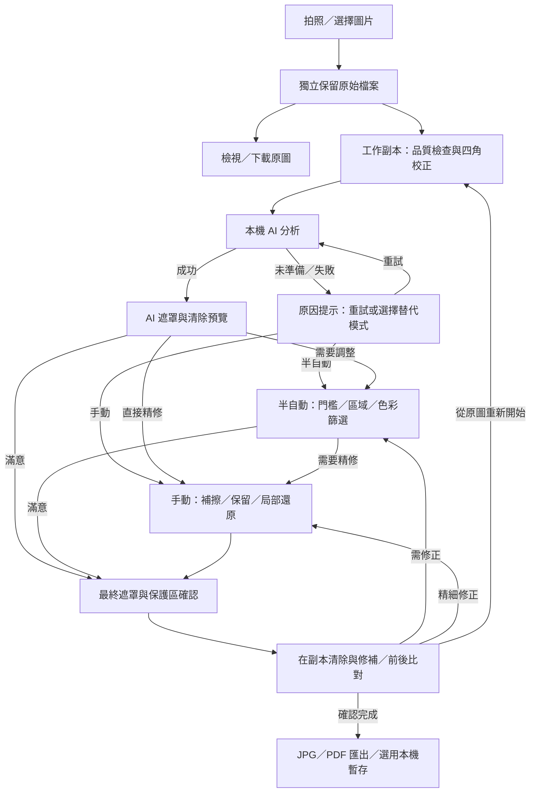

# 兒童考卷筆跡清除系統｜WEB 本機免費方案開發規劃

> **文件版本：** v1.2
> **規劃日期：** 2026-10-29  
> **修訂重點：** AI 辨識 → 清除筆跡 → 紙張與線條修復 → 半自動／手動確認；原圖獨立保留
> **方案選擇：** A — 完全免費、僅在使用者裝置本機處理  
> **用途：** 產品需求規格（PRD）、技術評估、開發任務與驗收基準  
> **平台：** 手機、平板與電腦的 WEB 瀏覽器（可規劃成 PWA）

---

## 1. 專案目標與重要結論

本專案旨在製作一個「已作答兒童考卷／學習單筆跡清除」WEB 工具。使用者可透過手機拍照或從相簿選取考卷圖片，先由本機 AI 分析手寫答案與批改痕跡，產生清除建議及預覽；需要修正時依序使用半自動調整、手動精修，確認後匯出 JPG 或 PDF。原始照片獨立保留，所有校正、預覽與清除均作用於工作副本。

### 1.1 不可妥協的需求

1. **考卷內容完全在本機處理**：不呼叫付費或免費雲端影像 AI API，不將使用者照片、遮罩或輸出結果上傳至任何伺服器。
2. **零必要 API 費用**：優先使用免費、開源且授權適用的前端套件；靜態網頁可部署於免費主機。
3. **盡量完整保留印刷題目**：原始印刷文字、數學符號、表格、線條與圖片的保護優先於「百分之百刪乾淨」。
4. **使用者有最終控制權**：AI 模型輸出「建議移除的筆跡遮罩（Mask）」，系統依遮罩在預覽副本產生清除效果；使用者檢視並確認後才套用至編輯結果，亦可先進入半自動或手動修正。
5. **行動裝置可操作**：手機、平板與桌機均可使用；不需要開發原生 Android／iOS App。
6. **輸出與備份**：支援 JPG、單頁／多頁 PDF；已匯出的檔案存到裝置，而非雲端。
7. **原圖獨立保留**：保留匯入檔案的原始資料與方向資訊，編輯與匯出均建立副本；支援檢視、下載原圖及從原圖重新開始。本機暫存仍受瀏覽器資料清理影響，依第 6.4 節提供備份提醒。

### 1.2 核心技術決策

**產品處理順序與開發優先順序均以「先 AI、再半自動、最後手動」為原則，原圖獨立保留。** 原圖匯入、校正、保護區、復原與匯出是共用基礎，支援各層處理。

- **先 AI：** 校正完成後，預設由本機 AI 分析整頁，產生筆跡遮罩、需人工確認區域及清除預覽；模型只負責分割，清除由局部填補／修補程序完成。
- **再半自動：** AI 結果需要調整時，提供門檻、區域選取、紅／藍筆色彩篩選、候選增減與保留區等操作。
- **最後手動：** 仍有殘留或誤選時，用筆刷補擦、扣除遮罩及局部還原完成精修。
- **滿意即可完成：** AI 結果經確認後可直接匯出；半自動與手動層依需要使用，亦可直接進入手動層。
- **例外處理：** 模型尚未準備、載入失敗或裝置效能不足時，清楚說明狀態，提供重試及切換半自動／手動工具。替代流程須明確標示，AI 功能另依模型驗收結果判定完成。

建議架構：

```text
照片／圖片
    ↓
獨立保留原始檔案 → 可檢視／下載原圖／從原圖重新開始
    ↓
建立彩色工作副本、裁切、旋轉、四角透視校正
    ↓
本機 AI 筆跡分割 → 遮罩與清除預覽
    ↓
檢視結果：滿意可確認匯出；需調整則往下
    ↓
半自動調整：門檻、區域、色彩篩選、候選增減
    ↓
手動精修：筆刷補擦、保留、局部還原
    ↓
最終遮罩扣除保留區 → 確認 → 局部清除及修補
    ↓
處理前後比對 → 確認 → 本機儲存、JPG／PDF 匯出
```

> **技術限制：** 當黑色手寫內容與黑色印刷文字完全重疊、原題目像素已被遮蔽時，單張照片無法保證還原被遮住的原始內容。系統應標記「建議人工確認」，保留原始資訊供比對。
>
> **AI 優先的開發前提：** 先以合法模型與真實考卷完成瀏覽器概念驗證，再安排完整開發期程；目前仍屬規劃，模型品質、速度及裝置相容性均待驗證。

---

## 2. 功能規格

### 2.1 AI 優先 MVP：可實際使用的免費 WEB 版

本節為整合版 MVP 的範圍，需包含 AI 主流程、半自動調整與基本手動精修；第 8 節的 AI Beta 為中間驗證成果。

| 模組 | 功能 | 優先級 | 驗收要點 |
|---|---|---|---|
| 取得考卷 | 手機拍照、相簿或檔案選取 JPG／PNG | P0 | 能在手機與桌機載入並預覽 |
| 圖片管理 | 原圖獨立保存、縮圖預覽、下載原圖、重新選取 | P0 | 原始檔案資料保持不變；所有修改作用於副本 |
| 校正 | 裁切、90 度旋轉、小角度校正、四角透視 | P0 | 紙張方向與邊界正確 |
| AI 優先分析 | ONNX 本機筆跡分割、機率遮罩、需確認區標記 | P0 | 正常路徑先執行 AI，實際推論在裝置端完成 |
| AI 清除預覽 | 根據 AI 遮罩及保護區產生暫時清除結果 | P0 | 可比較、取消、確認；原圖與已確認版本獨立保留 |
| 半自動調整 | 選區、門檻、紅／藍色篩選、候選區域增減 | P0 | 能修正 AI 過選與漏選；圈選範圍與清除像素分開顯示 |
| 手動精修 | 清除筆刷、遮罩扣除、保留筆刷、局部還原 | P0 | 可在 AI／半自動結果上精修，恢復誤刪內容 |
| 印刷內容保護 | 系統保護建議、人工指定保留區 | P0 | 人工保留區優先；實際清除像素與最終預覽一致 |
| 圖片修補 | 局部背景色估計或鄰域修補 | P0 | 在副本清除，重疊題目保守處理並提示 |
| 對照及復原 | 原圖／校正底圖／成果比對、Undo／Redo、重新開始 | P0 | 三層操作皆可撤銷；局部還原取自未清除的校正底圖 |
| 失敗替代流程 | AI 重試、半自動模式、手動模式 | P0 | 明確顯示 AI 不可用原因及目前模式 |
| 輸出 | JPG、單頁 PDF | P0 | 以確認後遮罩輸出，可在裝置開啟與列印 |
| 本機暫存 | IndexedDB／OPFS 儲存原圖、操作與各層遮罩 | P1 | 可恢復編輯進度，並提示網站資料清理風險 |
| 離線使用 | PWA、程式與模型資源快取 | P1 | 主要資源與模型快取完整後，可離線完成 AI 主流程 |
| 多頁輸出 | 多頁管理及合併 PDF | P1 | 逐頁處理與匯出，控制記憶體用量 |

**建議額外加入：** 高解析度縮放、筆刷尺寸調整、遮罩半透明顯示、彩色印刷保留模式及匯出／分享狀態提示。進階亮度、去陰影及白底增強列為 P1，保留彩色分析底圖。

### 2.2 第二層：半自動調整

- 以 AI 結果為起點，允許調整遮罩門檻、指定偵測範圍、增減候選及保留內容。
- OpenCV.js 從彩色底圖分析紅／藍筆跡，作為補選或替代候選來源。
- 矩形／套索主要用於限定處理範圍；直接整區清除須獨立操作並先顯示預覽。
- 適用於 AI 過選、漏選或不可用的情況；低信心與題目重疊區保留人工確認標記。

> 色彩與連通區域篩選屬傳統電腦視覺輔助，介面應與真正的 AI 推論分別標示。

### 2.3 第三層：手動精修與原圖復原

- 以筆刷精確加入／扣除實際清除遮罩，補擦殘留筆跡。
- 人工指定保留區具有最高保護優先權；可局部還原被誤刪的內容。
- 局部還原使用同一幾何座標的未清除校正底圖；完整重新開始則從原始檔案重建工作副本。
- 支援縮放、平移、筆刷尺寸及 Undo／Redo；全部操作記錄在副本與遮罩上。

---

## 3. 建議 WEB 使用流程

1. **首頁**：提供「拍攝考卷」「選擇圖片」，說明本機處理與 AI 優先流程。
2. **取得並保留原圖**：獨立保存匯入檔案，建立可編輯副本，提供重拍與原圖下載。
3. **品質檢查及校正**：檢查模糊、缺角、反光，調整旋轉與紙張四角；建立固定座標的彩色校正底圖。
4. **AI 優先分析**：首次使用顯示模型下載及準備進度，準備完成後在本機分析；已快取模型可離線使用。重跑分析由使用者觸發。
5. **AI 預覽**：顯示候選遮罩、保護建議、低信心／交疊區及清除預覽。滿意可直接前往最終確認。
6. **半自動調整（需要時）**：調整門檻、區域與色彩條件，增減候選及指定保留區，更新預覽。
7. **手動精修（需要時）**：用筆刷補擦、扣除或局部還原；支援逐筆撤銷與重做。
8. **最終確認**：顯示真正會修改的像素，扣除保留區；比較未清除底圖與成果，確認後套用至工作副本。
9. **儲存與匯出**：下載 JPG／單頁 PDF；本機暫存、離線及多頁功能依優先級加入。

**例外分支：** AI 尚未準備或執行失敗時，顯示原因與重試入口，使用者可切換半自動或手動模式；考卷處理仍維持本機執行。

### 3.1 Mermaid 流程圖



### 3.2 手機／平板 UI 方向

- 編輯頁依序呈現「AI 結果 → 半自動調整 → 手動精修」，預設停留於 AI 結果。
- 校正工具在分析前完成；重新裁切或透視時，先提醒使用者，重建底圖並重做受影響的遮罩。
- 常用操作為「確認結果、半自動調整、手動精修、保留、復原、匯出」，另提供明確的原圖檢視入口。
- 半自動的圈選範圍與實際清除遮罩以不同樣式呈現。
- 支援筆刷尺寸、遮罩透明度、觸控縮放與平移；保留區優先於各層清除候選。
- 重跑 AI 時保留人工修正紀錄，透過各層遮罩重新合成結果。
- 匯出前提示確認文字、數學符號、表格與圖片完整性。

---

## 4. 免費技術組合與授權

以下版本號是研究當時的建議基準；**實際開工前應重新核對相容性與安全修補**。套件免費不等於 AI 模型自動可用，也不代表所有第三方研究資料可商用。

| 元件 | 建議版本／方向 | 主要用途 | 授權或備註 | 必要性 |
|---|---|---|---|---|
| React + TypeScript + Vite | 穩定版 | WEB 前端、介面、建置 | 開源 | 核心 |
| Cropper.js | 2.3.1 | 圖片裁切／基礎旋轉 | MIT | 核心 |
| Fabric.js | 7.4.0 | Canvas 選區、Mask 筆刷、編輯 | MIT | 核心 |
| OpenCV.js | 固定經測試的 5.0.x build | 透視、閾值、影像清理、局部修補 | Apache-2.0；先確認打包模組功能 | 核心 |
| ONNX Runtime Web | 1.31.x | 瀏覽器本機 AI 推論 | MIT；WASM 基線，WebGPU 可選 | 核心 |
| 筆跡分割模型 | 經驗證的輕量 ONNX 模型 | 產生 AI 筆跡遮罩 | 模型、權重與訓練資料授權分別核對；目前待驗證 | 核心 |
| Tesseract.js | 7.0.0 | OCR、輔助找印刷文字位置 | Apache-2.0；不是筆跡清除模型 | 選用 |
| pdf-lib | 1.17.1 | 建立及合併 PDF | MIT；需注意維護與相容性 | 核心 |
| IndexedDB | 瀏覽器內建 | 編輯紀錄、索引、設定 | 無 API 費用 | 核心 |
| OPFS | 瀏覽器內建 | 儲存原圖、處理圖片等大型檔案 | 受瀏覽器空間限制 | 建議 |
| Service Worker / PWA | 瀏覽器內建 | 離線資源快取、主畫面安裝 | 須 HTTPS | 建議 |
| Cloudflare Pages | 免費靜態託管 | 發布 WEB 網頁與模型檔 | 免費方案有額度與檔案限制 | 建議 |

**首版核心：** `React + TypeScript + Vite + Cropper.js + Fabric.js + OpenCV.js + ONNX Runtime Web + 經驗證的合法筆跡分割模型 + pdf-lib`。  
**P1 擴充：** `IndexedDB/OPFS + PWA + 多頁 PDF`；僅在加入自動暫存時保留可恢復的完整專案資料。

### 4.1 離線與隱私設定原則

- 所有 JavaScript、WASM、OCR 語言資料及 `.onnx` 模型，由自己的靜態網站提供，避免執行時依賴外站 CDN。
- 首次連線時下載網頁與模型資源，分別顯示「編輯工具離線就緒」及「AI 模型離線就緒」；完整模型快取成功後才宣告 AI 可離線使用。
- 不使用 Google Analytics、第三方追蹤像素或會收集影像的服務。
- 不設圖片上傳 REST API、後端資料庫、雲端物件儲存或雲端 AI 金鑰。
- 若未來加入錯誤日誌，必須確保不包含圖片、OCR 題目內容與編輯資料。
- 部署平台只提供「程式與模型檔」，**不接收使用者處理中的考卷**。

---

## 5. AI 技術方案

### 5.1 影像預處理

1. 保留原始完整照片，僅建立工作副本。
2. 讀取影像方向並處理 EXIF 方向。
3. 自動估計紙張外框；若無法可靠偵測，使用四角拖曳介面。
4. OpenCV 透視變換把斜拍考卷轉成平面；保留幾何變換、校正底圖尺寸及遮罩座標規則。
5. 保留未清除的彩色校正底圖供 AI、色彩偵測與局部還原；亮度正規化依模型訓練設定處理，灰階／白底增強另作輸出選項。
6. AI 推論可先測試約 1600～2400 px 長邊工作圖；依實機能力設定解碼、處理與匯出的解析度上限，縮圖遮罩映射至輸出時重新檢查邊界。高解析度輸出、逐頁處理及資源釋放須實測，原圖保留原始檔案資料。

### 5.2 筆跡偵測策略：AI → 半自動 → 手動

**第一層：本機 AI 優先**

- 先取得或訓練授權適用的筆跡分割模型，以 ONNX Runtime Web 實際驗證。
- 輸入切片可測試 512×512 或 768×768 像素，切片保留重疊區；尺寸依品質與記憶體實測決定。
- 模型輸出每像素 `0~1` 筆跡機率值，產生 `aiMask` 與需確認區，系統另外計算局部清除預覽。
- 先驗證 WASM 基線，再加入 WebGPU 加速；5～20 MB 量化模型為工程目標，大小與效能均待驗證。
- 載入、推論或效能檢查失敗時提供明確替代模式，保留原圖與既有人工修改。

**第二層：半自動修正**

- 依門檻、選區及紅／藍筆色彩篩選調整 AI 候選，產生 `assistedMask`。
- 使用 adaptive threshold、morphology、connected components 作為輔助工具，從彩色底圖取樣。
- 使用者可加入漏選、扣除誤選及指定保留區；圈選範圍與實際待清除像素獨立表示。

**第三層：手動精修**

- 精確補擦形成 `manualEraseMask`；扣除誤選形成 `userRejectedMask`；保留筆刷形成 `manualKeepMask`。
- 局部還原透過扣除清除遮罩、從未清除校正底圖重新合成完成。
- AI、半自動與手動遮罩分開儲存，支援重跑 AI 後保留人工修正與撤銷紀錄。

### 5.3 保護印刷文字與版面

`protectedPrintMask` 可由線條、結構、OCR 及人工確認資訊提供建議；邊緣與 OCR 均屬輔助，實際保護效果須以真實考卷驗證。人工 `manualKeepMask` 具有最高保護優先權。

三層候選以同一張未清除校正底圖的座標合成；`userAllowedRegion` 預設為整頁，可由使用者縮小範圍。半自動／手動扣除的候選以 `userRejectedMask` 明確記錄。

示意計算（各候選先門檻化，`∪` 表示遮罩聯集）：

```text
candidateMask = aiMask ∪ assistedMask ∪ manualEraseMask

finalMask = postprocess(candidateMask)
          × userAllowedRegion
          × (1 - userRejectedMask)
          × (1 - protectedPrintMask)
          × (1 - manualKeepMask)
```

`postprocess` 包含去雜訊、膨脹與邊界處理；完成後再次裁除保留區與排除區，確保這些區域的清除權重為零。最終遮罩預覽、局部修補與匯出使用相同結果。交疊區優先保留並標記人工確認。

### 5.4 影像清除與修補

| 場景 | 優先方法 | 注意事項 |
|---|---|---|
| 白紙上獨立的彩色手寫字 | 估計周圍紙白色，局部填補 | 避免整張變純白，造成背景不一致 |
| 淺灰或不均勻紙面 | 鄰域顏色估計、局部修補 | 需維持紙張紋理與陰影 |
| 手寫經過表格線 | 保護線條，局部 Inpainting | 對重疊處設人工確認 |
| 手寫覆蓋原印刷字 | 保守保留或提示無法自動還原 | 不應虛構被遮住的題目 |

OpenCV 的 Telea／Navier–Stokes Inpainting 可作為局部修補方法，但需確認採用的 OpenCV.js WASM build 是否包含對應 `photo` 模組；若無則須自行編譯或採取替代實作。

### 5.5 可研究的學術模型，但不要直接當成已可部署成品

| 研究／資料 | 用途 | 主要限制 | 建議 |
|---|---|---|---|
| DeepErase（WACV 2020） | 分割文件上的多餘線條／筆跡，方法參考 | 老舊訓練環境；授權需確認；不等於已可用的瀏覽器模型 | 作為方法參考 |
| SCUT-EnsExam（ICDAR 2023） | 真實考卷手寫清除資料集，545 張 | 資料集限定非商業研究，授權 CC BY-NC-ND 4.0；需申請 | 僅按授權研究使用 |
| DocUnfold | 文件手寫污染移除研究 | 程式碼 MIT，但未提供經驗證的 ONNX Runtime Web 完整部署流程 | 中長期評估 |
| 自行訓練小型 U-Net | 產生可編輯的筆跡遮罩 | 需合法資料、訓練與跨設備效能測試 | 長期首選 |

**AI 優先的前置條件：** 目前尚未核實可直接滿足全部需求的現成模型，因此第一個里程碑是模型、授權與目標手機的概念驗證。通過後以 AI 主流程開發，接上半自動與手動工具；若未通過，應記錄限制並重新評估模型或支援範圍，AI 功能維持待完成狀態。

### 5.6 資料準備與模型訓練

- 優先採用自己拍攝、合法授權且可商用的乾淨考卷／學習單。
- 對乾淨考卷人工合成不同顏色、粗細與方向的手寫線條，同時產出精確的筆跡遮罩標籤。
- 覆蓋藍筆、紅筆、黑筆、鉛筆、注音、中文、英文、數學及插圖等場景。
- 另外保留未參與訓練的真實測試集，避免只測試合成效果。
- 模型訓練本身可在開發者電腦進行，**部署後推論仍完全在使用者瀏覽器本機**。

---

## 6. 前端架構與資料設計

### 6.1 系統架構

```text
Static WEB Hosting (僅提供網站程式和模型檔)
              │
              ▼
React + TypeScript 前端（使用者裝置）
   ├─ Camera / File Input
   ├─ 原始檔案：獨立保留；校正底圖及結果由副本建立
   ├─ Cropper.js／四角操作 UI：裁切、旋轉與透視參數
   ├─ Fabric.js：遮罩、圈選、筆刷、撤銷
   ├─ Web Worker
   │    ├─ ONNX Runtime Web：優先執行本機 AI 筆跡分割
   │    └─ OpenCV.js：半自動篩選、透視與局部修補
   ├─ 遮罩狀態：AI／半自動／手動／排除／保留分層，統一合成
   ├─ IndexedDB／OPFS（P1）：原圖、設定、遮罩與編輯歷史
   ├─ Service Worker（P1）：網頁、WASM、模型離線快取
   └─ pdf-lib / Canvas：JPG 與 PDF 匯出

使用者照片與清理結果：不傳回 Hosting 伺服器
```

### 6.2 程式模組介面示例

```ts
interface DocumentProcessor {
  detectPage(image: ImageBitmap): Promise<Quad>;
  rectify(image: ImageBitmap, quad: Quad): Promise<ImageBitmap>;
  preprocess(image: ImageBitmap): Promise<ImageBitmap>;
  segmentHandwriting(image: ImageBitmap): Promise<Mask>;
  clean(image: ImageBitmap, mask: Mask): Promise<ImageBitmap>;
}

interface LocalRepository {
  createDocument(meta: DocumentMeta): Promise<string>;
  saveOriginal(id: string, blob: Blob): Promise<void>;
  saveMask(id: string, blob: Blob): Promise<void>;
  saveVersion(id: string, version: EditVersion): Promise<void>;
  loadDocument(id: string): Promise<DocumentRecord>;
  deleteDocument(id: string): Promise<void>;
}
```

上述為架構示例，`Quad`、`Mask`、`DocumentMeta`、`EditVersion`、`DocumentRecord` 需於實作時定義。

### 6.3 本機資料結構（建議）

```text
documents
  id
  title
  createdAt
  updatedAt
  pageCount
  thumbnail
  latestVersionId

pages
  id
  documentId
  pageNo
  originalPath
  originalFileName
  originalMimeType
  originalOrientation
  rectifiedPath
  geometryTransform
  rectifiedWidth
  rectifiedHeight
  aiMaskPath
  assistedMaskPath
  manualEraseMaskPath
  userRejectedMaskPath
  manualKeepMaskPath
  protectedPrintMaskPath
  userAllowedRegionPath
  finalMaskPath
  resultPath
  width
  height

versions
  id
  pageId
  createdAt
  operations[]
  aiModelVersion
  maskThreshold
  preprocessSettings
  processingMode

settings
  modelVersion
  autoSave
  jpgQuality
  pdfPaperSize
```

**注意：** 原圖保存匯入檔案資料；編輯歷史記錄變更操作與各層 Mask。成果由未清除校正底圖、處理設定及遮罩重新合成。匯出解析度受裝置能力限制；JPG／PDF 為成果備份，可繼續編輯的專案備份另需包含原圖、校正參數、各層遮罩及操作紀錄。

### 6.4 本機儲存不等於永久保存

- IndexedDB／OPFS 均可能受到瀏覽器儲存空間額度、系統清理或使用者清除網站資料的影響。
- 可呼叫 `navigator.storage.persist()` 申請提高資料保留機會，但不是永遠不會被刪除的保證。
- 應提供刪除單頁、刪除全部資料、空間容量提示與備份功能。
- 使用者應將重要考卷匯出至裝置的「檔案」或「下載」資料夾。
- Safari／iOS 可能無法使用與 Chrome 相同的 `showSaveFilePicker()`；需提供標準下載與分享功能作為備援。

建議顯示提示文字：

> 專案暫存在此裝置的瀏覽器。清除網站資料或更換瀏覽器可能造成專案遺失；重要考卷請匯出 JPG 或 PDF 備份。

---

## 7. 服務費用與隱性成本

### 7.1 每月必要成本試算

| 項目 | 建議方案 | 預估月費 |
|---|---|---:|
| 網頁程式框架與 UI 套件 | 免費開源 | NT$0 |
| 裁切、影像處理、PDF 輸出 | Cropper.js／Fabric.js／OpenCV.js／pdf-lib | NT$0 |
| 本機 AI 推論引擎 | ONNX Runtime Web | NT$0 |
| Google Vision／Gemini／OpenAI 等雲端 API | **不使用** | NT$0 |
| 雲端圖片儲存 | **不使用** | NT$0 |
| 後端資料庫 | **不使用** | NT$0 |
| 靜態網頁託管 | Cloudflare Pages 免費方案 | 可 NT$0 |
| 網域 | 使用免費子網域 | NT$0 |
| **合計** | **在免費額度內、自己維護** | **NT$0／月** |

**適用前提：** 網站體積、使用量、部署次數與檔案數符合免費託管限制；不購買獨立網域、不租 GPU、不委外開發。這是**必要 API／主機月費估算**，不包括電力、開發工時及裝置硬體成本。

### 7.2 真正可能花錢的項目

| 成本類型 | 免費起步方式 | 何時可能產生成本 |
|---|---|---|
| 前端開發 | 自己開發／使用既有電腦 | 聘請工程師、外包 |
| AI 模型訓練 | 自有電腦／自製合成資料 | 要租借 GPU |
| 考卷資料 | 合法自製或取得授權 | 資料採集、授權與標註 |
| 效能測試 | 現有手機／平板 | 需添購測試設備 |
| 網域及部署 | 免費子網域、靜態託管 | 購買專屬網域或升級託管 |
| 長期維護 | 自行更新套件與修正問題 | 需要長期維運人力 |

**建議預算策略：** 維持每月必要 API／主機費 NT$0 的目標，先投入本機 AI 模型概念驗證；取得實際品質與裝置效能資料後，再安排介面、半自動與手動功能。模型或資料開發工時單獨估算，考卷處理維持本機執行。

---

## 8. 分階段開發計畫與工作清單

> 開發順序依 AI 主流程 → 半自動調整 → 手動精修安排；必要的原圖保存、校正、保護及復原機制屬共用基礎。舊版手動 MVP 的 4～6 週及含 AI 累計 8～12 週估算，須以 AI 概念驗證結果重新評估。

### Phase 0｜AI 可行性與專案準備

- [ ] 檢查模型、權重及訓練資料授權，選擇可驗證的候選模型。
- [ ] 以真實考卷驗證筆跡分割、印刷保護、低信心區與局部清除預覽。
- [ ] 在目標 iPhone／Android／桌機測試 ONNX WASM、可用時的 WebGPU、時間與記憶體。
- [ ] 評估彩色印刷、淡鉛筆及重疊題目的實際限制。
- [ ] 記錄概念驗證結果、支援範圍及後續模型／訓練工作。
- [ ] 建立 React + TypeScript + Vite、Git、建置及版本鎖定流程。

**里程碑：** 有實際可執行的合法模型、品質與裝置測試結果後，確立 AI 開發期程；未通過時保留待解問題與替代模式規劃。

### Phase 1｜共用圖片與安全編輯基礎

- [ ] 手機拍照、圖片格式檢查、原圖獨立保存與下載。
- [ ] 建立工作副本、裁切、旋轉、四角透視及固定座標的彩色校正底圖。
- [ ] 實作保留區、最終遮罩合成、取消、Undo／Redo 及局部重新合成。
- [ ] 完成比對、基本縮放與單頁 JPG／PDF 匯出，讓 AI 結果可檢查。
- [ ] 設定工作與輸出解析度上限、資源釋放及錯誤處理。

### Phase 2｜AI 主流程 Beta

- [ ] 整合 ONNX 模型、下載／載入狀態及 WASM 基線推論。
- [ ] 產生 AI 遮罩、清除預覽及需確認區標記。
- [ ] 提供最基本的候選扣除、保留及撤銷操作。
- [ ] 連接「分析 → 預覽 → 確認 → 副本清除 → 匯出」。
- [ ] 實作重試與 AI 不可用狀態，測試原圖資料保持不變。

**里程碑：** AI 能在受支援裝置完成主要流程；本階段為 Beta，整合版 MVP 仍需補齊後續兩層工具。

### Phase 3｜半自動調整

- [ ] 門檻、處理選區、紅／藍筆色彩篩選。
- [ ] 候選增減、連通區域過濾及保留區確認。
- [ ] 區分偵測範圍與直接擦除範圍，更新實際清除預覽。
- [ ] 支援 AI 結果修正及 AI 不可用時的半自動替代模式。

### Phase 4｜手動精修與整合版 MVP

- [ ] 清除筆刷、遮罩扣除、保留筆刷、局部還原及觸控操作。
- [ ] 串接三層遮罩與統一 Undo／Redo，驗證重跑 AI 保留人工修正。
- [ ] 完成「AI → 半自動 → 手動」與滿意即可匯出的所有路徑。
- [ ] 完成原圖比對、下載原圖、重新開始及 JPG／單頁 PDF 匯出。

**里程碑：** 完成第 2.1 節全部 P0 項目，以 AI 主流程提供使用，半自動與手動工具可按需接手。

### Phase 5｜P1 擴充與正式品質強化

- [ ] IndexedDB／OPFS 自動暫存、專案恢復與可編輯專案備份。
- [ ] PWA、網頁／WASM／模型快取及完整離線驗證。
- [ ] 多頁管理、逐頁處理及多頁 PDF。
- [ ] 進階去陰影、白底增強與列印品質調整。
- [ ] 中文、注音、數學、表格、插圖、鉛筆、擦拭痕跡及批改紅筆測試。
- [ ] iOS Safari、Android Chrome、桌面主要瀏覽器、零上傳與記憶體測試。
- [ ] 完成可讀錯誤訊息、模式說明、空間提示與備份提醒。

---

## 9. 驗收標準與測試矩陣

### 9.1 必測設備與資料

| 類別 | 測試範圍 |
|---|---|
| Android | 中階與旗艦手機，Chrome |
| iPhone | 舊一點的仍受支援機型、新款機型，Safari |
| iPad | Safari，直向／橫向與觸控筆操作 |
| Windows | Chrome、Edge、Firefox |
| macOS | Safari、Chrome |
| 解析度 | 1280×720、12MP、24MP、48MP 原圖 |
| 題目內容 | 中文、英文、注音、數學、表格、插圖 |
| 筆跡 | 黑、藍、紅筆、鉛筆、螢光筆 |
| 拍攝情境 | 平掃、斜拍、陰影、反光、皺紙、模糊 |
| 網路情境 | 首次連線下載資源、快取完成後完全離線 |

### 9.2 功能性驗收（MVP）

- [ ] 可在受支援手機完成「拍照 → 保留原圖 → 校正 → 本機 AI → 清除預覽 → 確認 → 匯出」。
- [ ] AI 結果滿意時可直接確認；需要時可依序進入半自動及手動層，亦可直接手動精修。
- [ ] 實際 AI 推論、半自動修正與手動替代模式有清楚標示，失敗原因可見且可重試。
- [ ] 原圖檔案資料在校正、AI、半自動、手動及匯出後保持不變；下載原圖可與匯入檔案比對。
- [ ] 局部還原來自未清除校正底圖；從原圖重新開始可重建乾淨工作狀態。
- [ ] 手動畫出「不可刪除」區後，任何清除操作不得覆蓋該區。
- [ ] 至少可撤銷、重做、重拍與重新選取圖片。
- [ ] JPG 和 PDF 在一般裝置可開啟及列印，文字不糊掉。
- [ ] 不需登入、不需要 API 金鑰、不需網路後端。
- [ ] 以瀏覽器 Network 面板驗證：**考卷圖片內容不對外送出**。
- [ ] P1 離線功能完成後，網頁、WASM 與模型快取齊全的受支援瀏覽器可離線重啟並完成 AI 主流程。
- [ ] 清除網站資料的風險有明確提示，使用者能下載原圖及匯出成果；P1 專案備份需可恢復各層遮罩與校正參數。

### 9.3 AI 主流程的建議驗收目標（非現成實測）

| 指標 | AI Beta 參考目標 | 正式版參考目標 |
|---|---:|---:|
| 手寫遮罩 Mask F1 | ≥ 0.88 | ≥ 0.92 |
| 印刷內容保留率 | ≥ 97% | ≥ 99% |
| 明顯錯刪印刷字的頁面比例 | < 5% | < 1% |
| 自動處理後不需人工修正的頁面 | ≥ 60% | ≥ 80% |
| 本機 AI 單頁推論時間 | 實機測試 | WebGPU < 5 秒／WASM < 10 秒為工程目標 |
| 離線可用性 | 已快取後正常 | 完整主要功能 |

**提醒：** 上表是產品目標，實際可達水準由 Phase 0 概念驗證決定。AI 原始結果與經半自動／手動修正的成果需分開評估，另記錄修正時間與接手比例。印刷保留率需以印刷前景及重要符號定義，逐頁檢查題意是否改變。單頁推論時間與模型首次下載／載入時間分開記錄。

建議正式測試集規劃：500～1,000 張未參與訓練的考卷頁面，並另準備 50～100 張高難度案例（筆跡重疊、數學符號、小字、圖表、淡鉛筆、陰影等）。對個人低用量 MVP 可先以小規模測試集驗證核心流程，再擴充。

---

## 10. 主要風險與對應方法

| 風險 | 影響 | 緩解策略 |
|---|---|---|
| 手寫與印刷內容重疊 | 可能刪掉題目字／數學符號 | 保護遮罩優先、人工確認、保留原圖 |
| 無可直接使用的合法瀏覽器模型 | AI 主流程與整體期程可能延後 | Phase 0 先驗證模型及授權；未通過則重估模型與支援範圍，替代模式清楚標示 |
| iOS Safari／部分手機不支援 WebGPU | 本機 AI 速度較慢 | ONNX WASM fallback、限制工作圖與切片大小 |
| 高解析度照片記憶體過大 | App 卡住或瀏覽器分頁被回收 | 工作圖縮圖、tile 處理、Web Worker、主動釋放資源 |
| IndexedDB／OPFS 資料被清除 | 專案內容遺失 | 顯著提醒、正式 JPG／PDF 匯出、備份功能 |
| 外部 CDN／模型依賴 | 離線失敗、外部網路接觸增加 | JS／WASM／ONNX／OCR 全部 self-host 並快取 |
| 手機拍照模糊、缺角或反光 | 題目清理效果差 | 拍攝品質提示、重新拍攝與手動透視校正 |
| 使用研究資料與模型授權不符 | 法律與後續公開部署風險 | 逐項檢查授權；自製／合法取得資料優先 |
| 開源套件更新或安全問題 | 相容性及安全風險 | 鎖定版本、定期更新、依賴掃描與回歸測試 |

---

## 11. 開發優先順序與最終建議

**確定順序：先 AI → 再半自動 → 最後手動；全程保留原圖。**

1. **先完成 AI 可行性驗證與主流程：** 優先確認合法筆跡分割模型能在目標瀏覽器運作，再建立可檢視、可撤銷的清除預覽。
2. **再提供半自動調整：** 以門檻、區域與色彩條件修正 AI 候選，降低逐筆描繪的工作量。
3. **最後提供手動精修：** 以補擦、保留、扣除與局部還原處理剩餘問題。
4. **原圖獨立保留：** 原始檔案維持匯入狀態，校正、清除與匯出均使用副本；可下載原圖及重新開始。
5. **結果按需接手：** AI 結果滿意即可確認匯出；不滿意時使用後續層，AI 失敗時顯示原因及替代選項。
6. **維持本機與題目保護原則：** 程式及模型由靜態主機提供，影像解析、推論與清除在裝置端完成；重疊處保守處理並人工確認。

### 11.1 專案完成定義

此 WEB 工具應至少做到：

- 開啟網址即可拍照或選取一張考卷，原始檔案獨立保留。
- 受支援裝置的正常路徑預設執行本機 AI，顯示筆跡遮罩及清除預覽。
- 可按需使用半自動調整及手動精修，並以最終遮罩確認實際清除範圍。
- 保留區優先、操作可撤銷、局部可還原，原圖可下載及用於重新開始。
- AI 失敗時清楚標示狀態，仍有半自動或手動替代模式。
- 可下載確認後 JPG／單頁 PDF，手機及平板可操作；暫存、離線及多頁 PDF 依 P1 驗收。
- API／主機必要月費以免費額度內 NT$0 為目標，使用者考卷在裝置端處理。

**開發決策：** AI 是首要能力與第一個驗證里程碑，半自動和手動是使用者逐步修正結果的工具。模型、授權及實機測試先決定可交付範圍，再安排工期；全程以原圖獨立保留、清除前可確認及印刷內容保護作為驗收基礎。

---

## 12. 參考資料與技術來源

> 本文件依據截至 **2026-10-29** 的公開技術資料與前述研究報告整理；第三方版本、價格及授權可能變動，實作前請再次查閱官方說明。

### 官方文件

1. [ONNX Runtime Web — JavaScript browser runtime](https://onnxruntime.ai/docs/get-started/with-javascript/web.html)
2. [ONNX Runtime Web — WebGPU execution provider](https://onnxruntime.ai/docs/tutorials/web/ep-webgpu.html)
3. [OpenCV.js — 使用教學](https://docs.opencv.org/5.0/js_tutorials/js_setup/js_usage/js_usage.html)
4. [OpenCV — Image Inpainting](https://docs.opencv.org/5.0/main_modules/photo_inpaint.html)
5. [Cropper.js](https://github.com/fengyuanchen/cropperjs)
6. [Fabric.js](https://fabricjs.com/)
7. [Tesseract.js](https://github.com/naptha/tesseract.js)
8. [Tesseract.js — 本地載入設定](https://github.com/naptha/tesseract.js/blob/master/docs/local-installation.md)
9. [pdf-lib](https://pdf-lib.js.org/)
10. [MDN — Origin private file system](https://developer.mozilla.org/en-US/docs/Web/API/File_System_API/Origin_private_file_system)
11. [MDN — Storage quotas and eviction](https://developer.mozilla.org/en-US/docs/Web/API/Storage_API/Storage_quotas_and_eviction_criteria)
12. [MDN — Service Worker](https://developer.mozilla.org/en-US/docs/Web/API/ServiceWorker)
13. [MDN — 拍照／攝影機存取](https://developer.mozilla.org/en-US/docs/Web/API/MediaDevices/getUserMedia)
14. [MDN — 檔案輸入 capture 屬性](https://developer.mozilla.org/en-US/docs/Web/HTML/Reference/Attributes/capture)
15. [MDN — showSaveFilePicker](https://developer.mozilla.org/en-US/docs/Web/API/Window/showSaveFilePicker)
16. [Cloudflare Pages — Pricing](https://developers.cloudflare.com/pages/functions/pricing/)
17. [Cloudflare Pages — Limits](https://developers.cloudflare.com/pages/platform/limits/)

### AI 與考卷筆跡清除研究

18. [DeepErase — GitHub](https://github.com/yikeqicn/deeperase)
19. [DeepErase — WACV 2020 論文](https://openaccess.thecvf.com/content_WACV_2020/papers/Qi_DeepErase_Weakly_Supervised_Ink_Artifact_Removal_in_Document_Text_Images_WACV_2020_paper.pdf)
20. [SCUT-EnsExam — 考卷手寫清除資料集](https://github.com/SCUT-DLVCLab/SCUT-EnsExam)
21. [EnsExam — UCL 論文資料](https://discovery.ucl.ac.uk/id/eprint/10174246/)
22. [DocUnfold — GitHub](https://github.com/CXH-Research/DocUnfold)

---

*文件用途：方便開發人員依規格開始實作、拆分開發任務與驗證本機免費方案。不代表相關程式或 AI 模型已完成實作。*


## 13. v1.2 清除後修復與題目還原需求

- AI 主流程完成筆跡候選後，應清除完整筆畫與淡色殘邊，再修復紙張背景，預設呈現修復成果供比對。
- 整合神經分割、連通筆畫及相對紙色的彩筆補強；清楚答案底線上方可提供黑筆／鉛筆候選，題目區維持保守。
- 印刷底線、表格及抗鋸齒邊緣優先保護；有足夠同一直線取樣時可修復交疊處。
- 人工保留區始終優先。人工補擦可更正自動保護；還原題目從未清除底圖取回內容。
- 原始照片與未清除校正底圖均獨立保留，預覽、匯出使用同一組最終遮罩與修復設定。
- 原本已被手寫完全遮住的文字，不以生成式方法捏造；標示人工確認。
- 使用分離的乾淨參考、筆跡及印刷遮罩做品質回歸，分開驗證去除筆跡、修復紙面及保留印刷，並另行安排真實考卷驗收。
